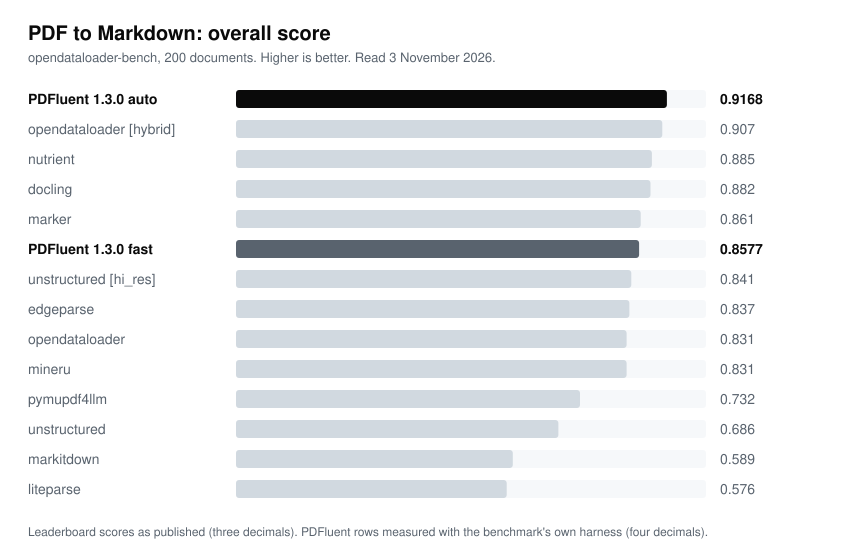

<p align="center">
  <a href="https://pdfluent.com/?utm_source=github&utm_medium=referral&utm_campaign=org_profile&utm_content=logo">
    
  </a>
</p>

<h1 align="center">PDFluent</h1>

<p align="center"><strong>A PDF editor and a PDF SDK on one Rust engine.</strong></p>

<p align="center">
  <a href="https://crates.io/crates/pdfluent"></a>
  <a href="https://pypi.org/project/pdfluent/"></a>
  <a href="https://www.npmjs.com/package/@pdfluent/node"></a>
  <a href="https://www.nuget.org/packages/PDFluent"></a>
  <a href="https://central.sonatype.com/artifact/com.pdfluent/pdfluent"></a>
  <br/>
  <a href="https://pdfluent.com/docs/?utm_source=github&utm_medium=referral&utm_campaign=org_profile&utm_content=badge_docs"></a>
  <a href="https://github.com/pdfluent/pdfluent-sdk/discussions"></a>
  <a href="https://github.com/pdfluent/pdfluent-sdk/blob/main/LICENSE"></a>
  <a href="https://pdfluent.com/download/?utm_source=github&utm_medium=referral&utm_campaign=org_profile&utm_content=badge_download"></a>
</p>

The engine is written in Rust with no C or C++ dependencies. The editor is free for everyone, including commercial use, and the SDK is AGPL-3.0 or commercially licensed.

<table>
<tr>
<td width="33%" valign="top"><b>Extraction for AI</b><br/>PDF to Markdown with reading order, tables and headings kept. Scanned pages get read.</td>
<td width="33%" valign="top"><b>One engine, every language</b><br/>Rust, Python, Node.js, .NET, Java, C and WebAssembly from the same code.</td>
<td width="33%" valign="top"><b>Private by design</b><br/>Everything runs on your machine. The editor needs no account and works offline.</td>
</tr>
<tr>
<td valign="top"><b>Forms, PDF/A, signatures</b><br/>AcroForm fill, PDF/A-1b/2b/3b, PAdES signatures, redaction that removes the content.</td>
<td valign="top"><b>Public benchmarks</b><br/>The harness, scorers and per-run results are open: <a href="https://github.com/pdfluent/pdfluent-bench"><code>pdfluent-bench</code></a>.</td>
<td valign="top"><b>For agents too</b><br/>An <a href="https://github.com/pdfluent/pdfluent-mcp">MCP server</a> that reads, searches and fills local PDFs.</td>
</tr>
</table>

---

## How it scores

<p align="center">
  <picture>
    <source media="(prefers-color-scheme: dark)" srcset="https://raw.githubusercontent.com/pdfluent/.github/main/profile/assets/odl-overall-dark.svg">
    
  </picture>
</p>

PDFluent 1.3.0 ranks above every engine on the published opendataloader-bench leaderboard (as of 3 November 2026)*.

<sub>*Overall score 0.9168 (quality="auto", keep_furniture=True, Linux) against the engines listed in the benchmark README on 3 November 2026; submitted as pull request #37. Other engines have submissions open that are not yet on the leaderboard.</sub>

→ [Full tables, all four measures and how to reproduce](https://pdfluent.com/benchmarks/opendataloader-bench?utm_source=github&utm_medium=referral&utm_campaign=org_profile&utm_content=bench_chart)

---

## PDFluent Editor

The editor is free for everyone, including commercial use, with no account and no subscription. Documents are processed entirely on your device, and the only automatic network request is an update check you can switch off in Settings.

**[Download for macOS and Windows](https://pdfluent.com/download/?utm_source=github&utm_medium=referral&utm_campaign=org_profile&utm_content=editor_download)** · [Microsoft Store](https://apps.microsoft.com/detail/xpdbxj6xrlfqk2) · [Source](https://github.com/pdfluent/pdfluent) · [Licence](https://pdfluent.com/license/?utm_source=github&utm_medium=referral&utm_campaign=org_profile&utm_content=editor_license)

| Platform | Build |
|---|---|
| macOS | Universal binary (Apple Silicon and Intel), notarized |
| Windows | Installer, or the Microsoft Store |

---

## PDFluent SDK

The SDK is licensed under AGPL-3.0, or a commercial licence for anyone who cannot accept the AGPL's obligations. The commercial licence buys the right not to publish your source and unlocks no features; there is no licence key and every feature is in every build.

```bash
cargo add pdfluent                  # Rust
pip install pdfluent                # Python
npm install @pdfluent/node          # Node.js
npm install @pdfluent/sdk-wasm      # Browser (WebAssembly)
dotnet add package PDFluent         # .NET
```

Java is `com.pdfluent:pdfluent` on Maven Central; C and C++ link against the C API.

```rust
use pdfluent::prelude::*;

let doc = PdfDocument::open("in.pdf")?;
for page in doc.pages() {
    println!("{}", page.text()?);
}
```

```python
from pdfluent import Document

doc = Document("in.pdf")
for page in doc:
    print(page.extract_text())
```

```js
const { openPdf } = require('@pdfluent/node');

const doc = openPdf('in.pdf');
console.log(doc.extractText(0));
```

| Capability | Status |
|---|---|
| Text extraction with positions | Production |
| Rendering to PNG and JPEG (native bindings, not WebAssembly) | Production |
| AcroForm fill and flatten | Production |
| Digital signatures (PAdES B-B / B-T / B-LT) | Production |
| PDF/A validation and conversion (PDF/A-1b, 2b, 3b) | Production |
| Redaction that removes the content | Production |
| Merge, split, encryption | Production |
| XFA form flattening | Experimental |

→ [Documentation](https://pdfluent.com/docs/?utm_source=github&utm_medium=referral&utm_campaign=org_profile&utm_content=sdk_docs) · [Cookbook](https://pdfluent.com/cookbook/?utm_source=github&utm_medium=referral&utm_campaign=org_profile&utm_content=sdk_cookbook) · [Examples](https://github.com/pdfluent/examples) · [Source](https://github.com/pdfluent/pdfluent-sdk) · [Changelog](https://github.com/pdfluent/pdfluent-sdk/blob/main/CHANGELOG.md) · [Commercial licence](https://pdfluent.com/sdk/pricing/?utm_source=github&utm_medium=referral&utm_campaign=org_profile&utm_content=sdk_pricing) · [How we benchmark](https://pdfluent.com/benchmarks/how-we-measure/?utm_source=github&utm_medium=referral&utm_campaign=org_profile&utm_content=sdk_benchmarks)

---

## Community

Ask questions in [GitHub Discussions](https://github.com/pdfluent/pdfluent-sdk/discussions), in the Q&A category. Report bugs in the issue tracker of the repository the problem is in. Report security problems by email to [hello@pdfluent.com](mailto:hello@pdfluent.com), never in a public issue.

| You want to | Go to |
|---|---|
| Ask about the SDK | [SDK Discussions → Q&A](https://github.com/pdfluent/pdfluent-sdk/discussions/categories/q-a) |
| Ask about the editor | [Editor Discussions](https://github.com/pdfluent/pdfluent/discussions) |
| Show what you built | [Discussions → Show and tell](https://github.com/pdfluent/pdfluent-sdk/discussions/categories/show-and-tell) |
| Suggest a feature | [Discussions → Ideas](https://github.com/pdfluent/pdfluent-sdk/discussions/categories/ideas) |
| Report an SDK bug | [`pdfluent-sdk` issues](https://github.com/pdfluent/pdfluent-sdk/issues/new/choose) |
| Report an editor bug | [`pdfluent` issues](https://github.com/pdfluent/pdfluent/issues/new/choose) |
| Report a vulnerability | [hello@pdfluent.com](mailto:hello@pdfluent.com), see [SECURITY.md](https://github.com/pdfluent/.github/blob/main/SECURITY.md) |
| Buy a commercial licence | [hello@pdfluent.com](mailto:hello@pdfluent.com) |

---

## Repositories

| Repository | What is in it |
|---|---|
| [`pdfluent-sdk`](https://github.com/pdfluent/pdfluent-sdk) | The engine and every language binding. AGPL-3.0 or commercial. |
| [`pdfluent`](https://github.com/pdfluent/pdfluent) | The desktop editor: Tauri, React and TypeScript. Source-available. |
| [`pdfluent-mcp`](https://github.com/pdfluent/pdfluent-mcp) | MCP server for local PDFs: read as Markdown, text, tables or blocks, search, fill forms. |
| [`pdfluent-bench`](https://github.com/pdfluent/pdfluent-bench) | Benchmark harness for structured extraction: datasets by manifest, results per run. |
| [`examples`](https://github.com/pdfluent/examples) | Runnable SDK examples in Rust and the browser (WebAssembly). |
| [`hayro`](https://github.com/pdfluent/hayro) | Mirror of Laurenz Stampfl's pure-Rust PDF interpreter, which the rendering path builds on. |
| [`.github`](https://github.com/pdfluent/.github) | This page, and the default issue forms, contributing guide and security policy. |

---

<p align="center">Built by Innovation Trigger B.V. · <a href="https://pdfluent.com/?utm_source=github&utm_medium=referral&utm_campaign=org_profile&utm_content=footer">pdfluent.com</a></p>
